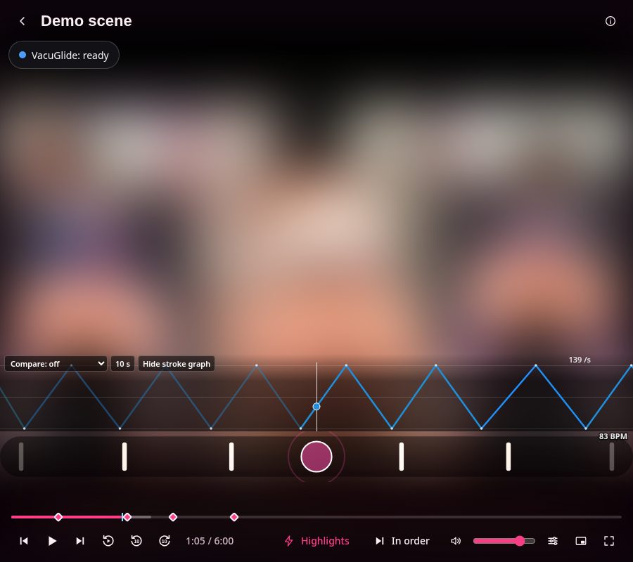
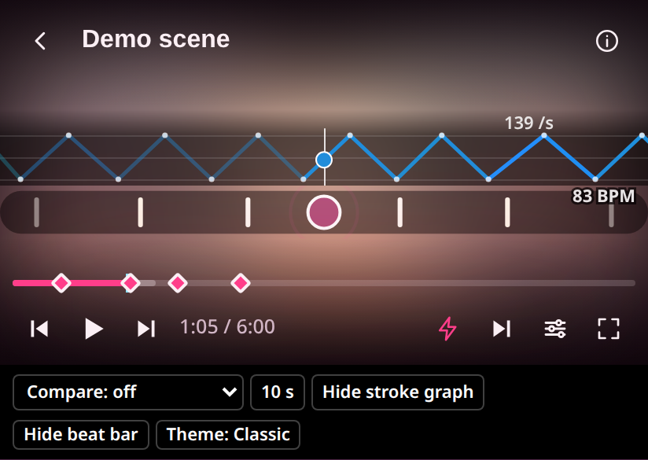
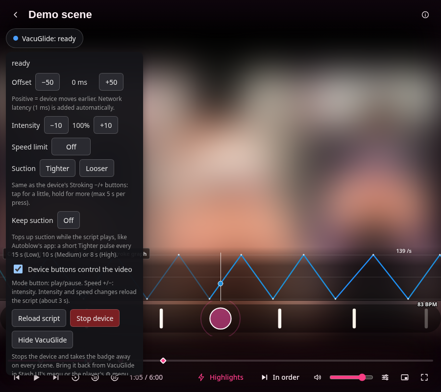
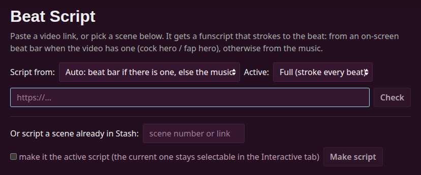

# driftsyncone's Stash plugins

Plugins for [Stash](https://stashapp.cc), mostly built around the
[Autoblow VacuGlide](https://autoblow.com/product/vacuglide/) and beat-synced PMVs.
Unofficial; not affiliated with Autoblow.

| Plugin | What it does |
|---|---|
| [VacuGlide Sync](#vacuglide-sync) | Plays a scene's funscript on a VacuGlide, from any browser |
| [Beat Script](#beat-script) | Makes a beat-synced funscript from a link or scene (beat bar or music) |
| [Beat Bar](#beat-bar) | Draws a fap-hero style beat bar over PMVs that don't have one |
| [Stroke Graph](#stroke-graph) | Moving stroke line over the player, coloured by speed |

All four work in classic Stash and in the [Stash UI](https://github.com/anonym88312/stash-pmv-plugins/tree/main/plugins/stashui)
interface, and follow the script you pick in
[Stash Interactive Tools](https://github.com/stashapp/CommunityScripts).

| Desktop: Stroke Graph, Beat Bar and the VacuGlide badge | Phone |
|---|---|
|  |  |

<sub>Screenshots from Stash UI with its NSFW mode blurring the video.</sub>

## Install

1. In Stash, open **Settings → Plugins → Available Plugins → Add Source**.
2. Name it `driftsyncone` and use this URL:

   ```
   https://driftsyncone.github.io/stash-plugins/main/index.yml
   ```

3. Expand the new source, tick the plugins you want, and click **Install**.

Updates show up in **Settings → Plugins** when a new version is published.

## VacuGlide Sync

Plays a scene's funscript on an Autoblow VacuGlide in sync with the video, from any browser, including phones. It uses Autoblow's cloud API, so nothing needs installing on the phone and no Bluetooth is involved.

**Setup**

1. Put the VacuGlide online (Autoblow online setup) and note its device token.
2. Hold the device's mode button for 2.5 s to enter online mode.
3. Open any scene that has a funscript and tap the **VacuGlide** badge (bottom left; top left of the player in Stash UI). Expand **Device token**, paste your token, and click **Save**.
4. Press play.



**Features**

- Play, pause and seek follow the video; the device stops when you pause, buffer, change playback speed, switch apps or leave the scene.
- Network latency is measured and compensated automatically, plus a manual offset (±50 ms steps).
- **Intensity** (20–200%) and a **speed limit** (500/400/300/200 per second) reshape the script for a gentler or stronger feel.
- **Device buttons**: the mode button plays/pauses the video, speed +/− change intensity.
- **Suction**: hold **Tighter** / **Looser** in the panel, same as the device's Stroking −/+ buttons (max 5 s per press). **Keep suction** (Off/Low/Med/High) tops it up automatically while a script plays.
- Follows the script you pick in Stash Interactive Tools (Interactive tab, including its modifiers) and in the Stash UI player; the device reloads only when the script actually changes.
- Stash UI: its own sidebar page and a toggle in the player menu. On phones the badge sits where it doesn't cover the controls.
- **Hide the VacuGlide badge** setting (or the badge's own Hide button) turns it off everywhere.
- Uploaded scripts are cached for 8 days, so reopening a scene loads in seconds.

**Requirements**

- A recent Stash release (tested on v0.31.1).
- A VacuGlide with online mode set up. Scripts are sent through Autoblow's servers.

## Beat Script

A **Beat Script** button in the top bar opens a page where you paste a video link (anything yt-dlp supports, plus PMVHaven) or a scene number. It downloads the video into your library and writes a funscript that strokes to the beat:

- **Beat bar** videos (cock hero / fap hero): it finds the on-screen bar and times one stroke per marker, the way commercial FULL / HALF scripts are made.
- **Music** otherwise: beat tracking on the soundtrack, stroke depth follows loudness.
- **Auto** picks the bar when there is one, else music.



Every run saves the variants side by side (`<video> Beat Bar FULL.funscript`, `… HALF`, `… Music`, …) so you can switch in Stash Interactive Tools; the one you choose becomes the scene's script. Scripts made by Beat Script are tagged "Beat script (auto)" and carry the beat times Beat Bar uses.

Settings: download folder (default `/data/PMV`), max video quality, stroke depth in quiet parts, max speed, shortest stroke, tag name.

The analysis is this plugin's own code (spectral-flux beat tracking and an on-screen bar detector). It runs inside the Stash container: it downloads yt-dlp and pip-installs numpy into its own folder on first use, and uses Stash's ffmpeg. If a plugin called FapTap Import is installed, PMVHaven links also get their tags and performers from it; without it, the title, link and cover are still set.

For the VacuGlide, keep the FULL strokes: it plays speed, not position, and full 0–100 strokes give it the full speed range.

## Beat Bar

Draws a fap-hero style beat bar over PMVs that don't have one, inside Stash's player (works fullscreen and on phones). Timed from the scene's active script: the beat times Beat Script writes, else the bottoms of the script's strokes.

Shown only on interactive scenes with a "show" tag (default `PMV, HMV, Beat script (auto)`) and none of the "skip" tags (default `Beat meter, Fap Hero, Cock Hero`), and never when the script was made from an on-screen bar.

- Themes: classic, angular, neon, minimal, approach, heartbeat. The **Theme** button on the bar cycles them (remembered per browser).
- Settings: position (bottom/top), size, look-ahead (scroll speed), timing offset, opacity, beat flash (edge glow on each beat), hide BPM, no tempo colours.
- Write your own theme: a JS file that registers `window.BeatBarThemes.<name>`; see [plugins/beatBar/README.md](plugins/beatBar/README.md).

## Stroke Graph

Draws the scene's funscript as a moving line over the bottom of the player, coloured by speed, so you can see what's coming.

- Window of 5 / 10 / 20 / 40 s, current speed shown, **Hide** button (remembered per browser).
- **Compare:** draws a second script of the same scene as a thin ghost line, handy for comparing variants.
- Stacks above Beat Bar when both are shown; hides itself on scenes without a script.

## License

[CC BY-NC-SA 4.0](LICENCE): use, change and share these plugins for **non-commercial** purposes, with credit; anything you build from them must be shared under the same license.

Versions published before this change (VacuGlide Sync up to 0.5.1) were released under AGPL-3.0 and stay available under it. `build_site.sh` comes from [stashapp/CommunityScripts](https://github.com/stashapp/CommunityScripts) and keeps its AGPL-3.0 license.
